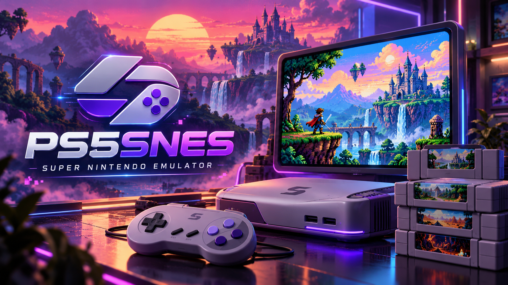

# PS5SNES is a passion project, not a piracy project.
<p align="center">
  
</p>
PS5SNES is a standalone PS5 homebrew emulator using the **bsnes-mercury balanced** core and the original PS5SX2 cover-flow interface. It is a separate project with its own application ID (`PPSA99205`) and data directory (`/data/PS5SNES`). Development and documentation were **AI-assisted**.

## Latest update

- Local and USB folders are scanned at startup even when a library cache exists.
- Offline IPv4 NAS checks avoid long startup retries and preserve local games.
- Empty-library hints use the correct PS5SNES folders and disappear when games are present.
- Press **R2** on the shelf to refresh the selected game's cover. The existing image is retained if downloading fails.
- The [SNES cover repository](https://github.com/Globaleliteee/Gaming_Console_Covers_Art_Repository/tree/main/covers/nintendo/SNES) supplies an index of **723 filenames**. Matching handles case, region, revision/language tags and common title punctuation, with libretro-thumbnails fallback.
- Earlier failed cover lookups are retried with the new cover-cache namespace.
- Menu branding is **v6 by YAHBALLON**.

The v6 repository URLs and image decoding were tested on the host. Validate the
new cover behavior on your PS5; compatibility across all ROM naming variants is
not guaranteed. The SNES core remains bsnes-mercury balanced.

## Features

- Animated game shelf with a charcoal and violet SNES theme.
- Cartridge formats: `.sfc`, `.smc`, `.swc`, `.fig`, including common 512-byte copier headers.
- Single-ROM ZIP loading in memory, with Stored or Deflate compression.
- Games from internal storage, USB and directly configured NFSv3 shares.
- Fast cached game library and a loading screen with scan progress.
- Battery saves, save/load states and configurable controller buttons and shortcuts.
- Native-clock stereo audio converted continuously to the PS5's 48 kHz audio output.
- Cover support and a local settings page accessible from a phone or computer.

## Installation

Use the application ZIP from a release. Copy its complete `PPSA99205` folder to `/data/homebrew/PPSA99205/` and launch it through your compatible PS5 homebrew launcher. Keep the included modules, filesystem helper and `sce_sys` files together.

The source archive is for development; it does not contain an installable executable.

Place games in `/data/PS5SNES/games/`, or on USB in `/mnt/usb0/homebrew/PS5SNES/games/`. USB0 through USB7 are supported. Additional USB folders and full installation details are in [INSTALL.md](INSTALL.md).

For NFS, open **All games → Settings → Network**, enter your export URL (for example `nfs://192.168.0.87/SNES`), save and restart the app. Use **Rescan game library** after changing the files on a share. The example URL is not an automatically configured server.

Configuration, saves, covers, cache and logs live under `/data/PS5SNES/`. The app uses `/download0/PS5SNES/` as a fallback when necessary. The local web settings page uses port **8844**.

## Default controls

| SNES / action | DualSense |
| --- | --- |
| A / B | Circle / Cross |
| X / Y | Triangle / Square |
| L / R | L1 / R1 |
| Start | Options |
| Select | Touchpad click / Create |
| Directions | D-pad / left stick |
| Save state | L3 + R3 + D-pad Up |
| Load state | L3 + R3 + D-pad Down |
| Return to game shelf | L1 + R1 + Touchpad click |

Open **Square → R2 / Controls** to customize buttons globally or per game. The menu combination also provides a two-second emergency hold after remapping. There is one save-state slot per ROM.

## Building from source

See [BUILDING.md](BUILDING.md) for the dependency layout and public upstream projects. The console build requires Linux/WSL, Clang/LLD 18 and a prepared public PS5 SDK, PS5_Vulkan, libnfs and HTTPS dependency environment.

```bash
PS5SNES_DEPS=/path/to/prepared/deps bash snes/tools/build.sh
```

Output: `snes/build-shelf/PS5SNES-v6-Repository-Covers-by-YAHBALLON.zip`.

The inherited root PCSX2 CMake project is not the PS5SNES app build entry point. Use the script above. Prepared binary dependencies are not included in this source archive; a complete fresh-machine dependency bootstrap is not provided.

Run the host integration test on Linux/WSL with Clang 18, Make and host zlib development headers:

```bash
python3 snes/tools/test.py
```

The test generates original LoROM and SPC700 code and checks real emulation, video, audio, controller inputs, battery saves, save states, ZIP loading, copier headers and PAL timing. No commercial ROM or Nintendo firmware is supplied. The build also verifies native memory parameters and signed executable integrity.

For a reproducible source ZIP and checksum verification, see [GITHUB_UPDATE.md](GITHUB_UPDATE.md).

## Scope and compatibility

Normal SNES cartridges and one active player are exposed. Enhancement-chip HLE is used where supported. Super Game Boy, Satellaview, Sufami Turbo, MSU-1 external data and light guns are not integrated into this frontend.

Automated testing was performed on the host. Successful PS5 operation has been reported by the user; compatibility and performance across all games have not been exhaustively tested.

## Project layout

| Path | Purpose |
| --- | --- |
| `snes/src/` | SNES frontend integration, storage, controller mapping and runtime |
| `snes/tools/` | Console build, memory checks and host tests |
| `snes/third_party/bsnes-mercury/` | Vendored, pinned SNES core |
| `snes/sce_sys/` | App metadata and launcher icon |
| `snes/assets/` | Supplied original logo |
| `ps5/frontend/` | Original PS5SX2 shelf and settings interface |
| `ps5/proto/native/` | Native application tooling |

## Credits and licenses

- **YAHBALLON** — customization and supplied logo.
- **Spyros and PCSX2 contributors** — original PS5SX2 frontend and scaffold.
- **bsnes-mercury / Libretro contributors** — SNES emulation core.
- **mihawk-99, BlackBearReloaded, Lapy and supporting library contributors** — PS5 graphics, SDK, native tooling and filesystem support.

Integration code is GPL-3.0-or-later. Preserve the original component notices and license texts when redistributing. See [COPYING.GPLv3](COPYING.GPLv3) and [THIRD_PARTY_NOTICES.md](THIRD_PARTY_NOTICES.md). This project is not affiliated with Nintendo, Sony or the upstream projects.
